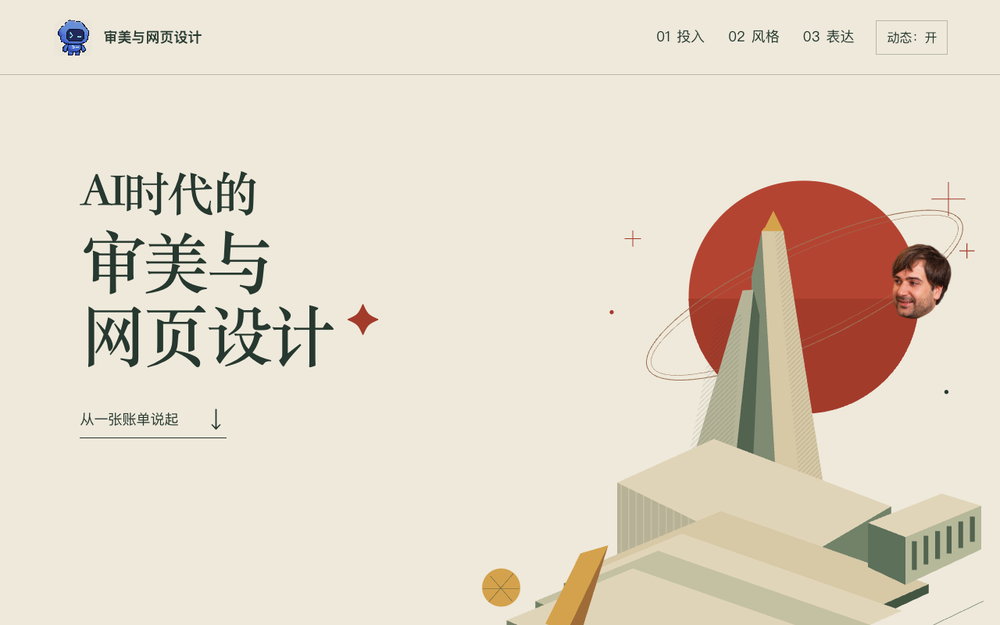

# AI时代的审美与网页设计

一次关于 AI 工具、网页设计与审美判断的交互分享。用两种风格不同的网页讨论一个问题：怎样让信息适合它的读者和使用情景？

[打开分享页](https://zeroplus657.github.io/ai-aesthetics-2026/) · [查看出游设计案例](https://zeroplus657.github.io/ai-aesthetics-2026/examples/day-out/)



## 内容

- 从工具投入出发，讨论 AI 使用的成本与时间。
- 对照高对比、动态的出游页面与中式山水风格的阅读页面。
- 用“情景、读者、信息”三个问题解释设计选择。

出游案例使用通用演示内容。文献库案例沿用原站的访问验证；内嵌预览默认不接管滚动，点击“操作网页”后启用交互。页面支持暂停动态效果和系统减少动态设置。

## 本地查看

原生 HTML、CSS 与 JavaScript，无需构建工具。可打开 `index.html` 查看主页面；检查内嵌案例时建议在仓库目录运行：

```sh
python3 -m http.server 8000
```

访问 `http://localhost:8000/`。

## 状态与素材

当前为可访问的交互分享页。费用与用量由分享者提供，不代表官方定价或平台审计结果。

几何纪念碑插画与末页低多边形雕塑为页面内构建的视觉素材；头像由分享者提供。产品图标用于指代相应工具，不表示官方合作或背书。第三方案例和品牌素材的权利归原权利人，不能据此推定整个仓库适用同一开源许可。
